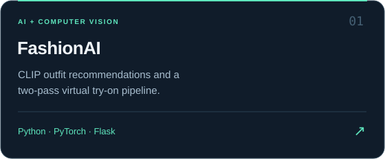
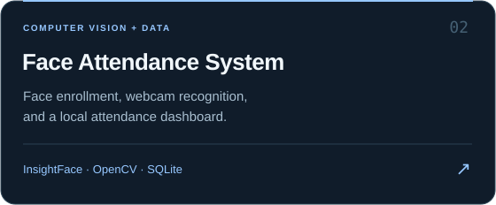
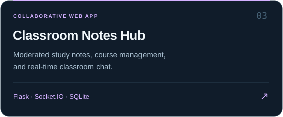
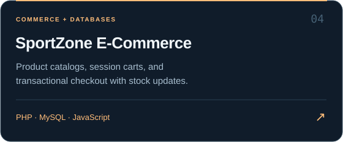
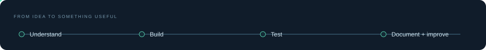
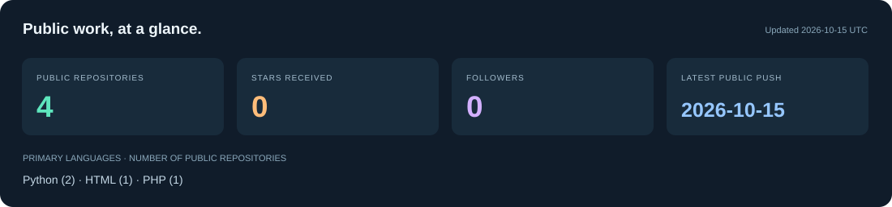

<!-- Profile repository: keep this repository name identical to the GitHub username. -->

  <picture>
    <source media="(max-width: 600px)" srcset="assets/header-mobile.svg" />
    
  </picture>

  <strong>Curious about AI. Hands-on with the web. Focused on useful software.</strong>

  
  
  

### A little about me

Hi, I'm **M. Abdullah** 👋 — a developer who enjoys connecting **AI, computer vision, and full-stack web development**. My projects range from outfit recommendations and face-recognition dashboards to classroom collaboration and e-commerce.

I like seeing a project through: the interface, the application logic, the database, and the setup instructions that help someone else run it. This profile brings together the things I'm building and the tools I work with.

### Featured work

**Pick a project to explore its source, screenshots, setup, and review notes.**

  
  
  
  

<strong>🔎 What I worked with in these projects</strong>

| Project | Technical focus | Explore |
|---|---|---|
| **FashionAI** | CLIP embeddings, complementary garment retrieval, segmentation crops, OOTDiffusion integration, background jobs. | [View project →](https://github.com/sheikhabdullah9july-commits/fashionai-virtual-try-on) |
| **Face Attendance** | Mean face embeddings, similarity thresholds, webcam integration, SQLite attendance and session workflows. | [View project →](https://github.com/sheikhabdullah9july-commits/face-attendance-system) |
| **Classroom Notes Hub** | Flask blueprints, upload moderation, role checks, notes, comments, Socket.IO chat, workflow tests. | [View project →](https://github.com/sheikhabdullah9july-commits/classroom-notes-hub) |
| **SportZone** | PHP sessions, prepared SQL queries, carts, stock checks, transactional orders, admin interfaces. | [View project →](https://github.com/sheikhabdullah9july-commits/sportzone-ecommerce) |

These are learning and prototype projects. Each repository documents its validation status, remaining limitations, and any original/upstream attribution.

### My toolkit

| Area | Technologies |
|---|---|
| **AI & computer vision** | Python · PyTorch · OpenCV · InsightFace · CLIP · scikit-learn |
| **Web development** | HTML · CSS · JavaScript · React · Flask · PHP · Socket.IO |
| **Data & databases** | NumPy · pandas · MySQL · MariaDB · SQLite · PostgreSQL · MongoDB · SQL Server · Redis |
| **Development workflow** | Git · GitHub · Linux · Bash · Docker |

<strong>🧰 Open the rest of my toolkit</strong>

| Area | Additional tools and languages |
|---|---|
| Languages & platforms | C · C++ · C# · Java · Android · Arduino · Qt · Unity |
| ML & visualization | TensorFlow · Seaborn · D3.js · Chart.js · CanvasJS |
| Cloud, observability & automation | Google Cloud · Grafana · Kibana · Zapier |

This is a toolkit overview, not an expertise ranking. The featured repositories show where particular technologies appear in working code.

### How I approach a build

Start with a concrete problem. Build a usable version. Check the main workflow. Document what works and what still needs attention.

<strong>📊 Explore my public GitHub snapshot</strong>

This panel uses public GitHub API data and refreshes daily through [GitHub Actions](https://github.com/sheikhabdullah9july-commits/sheikhabdullah9july-commits/actions/workflows/update-profile.yml). Private repositories are excluded. Language counts describe repositories, not proficiency or time spent coding.

---

<strong>Interested in AI applications, computer vision, or thoughtful web projects?</strong> 
<a href="https://www.linkedin.com/in/sheikh-muhammed-abdullah/">Let's connect on LinkedIn</a> · <a href="https://github.com/sheikhabdullah9july-commits?tab=repositories">Explore my repositories</a>

Learning through projects. Improving through iteration.

